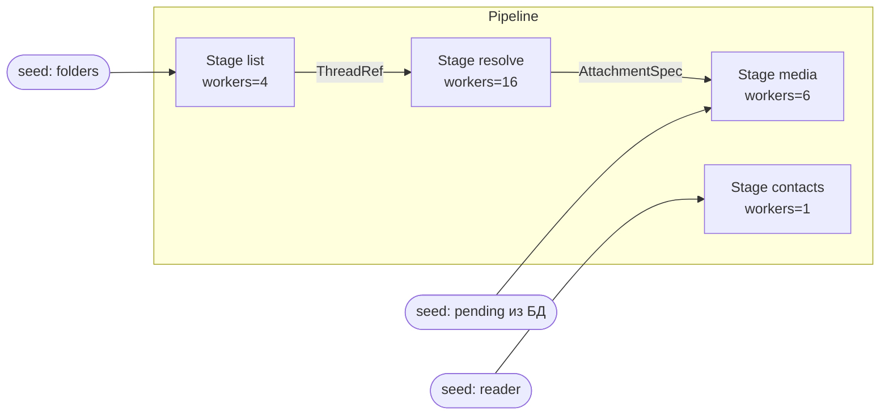
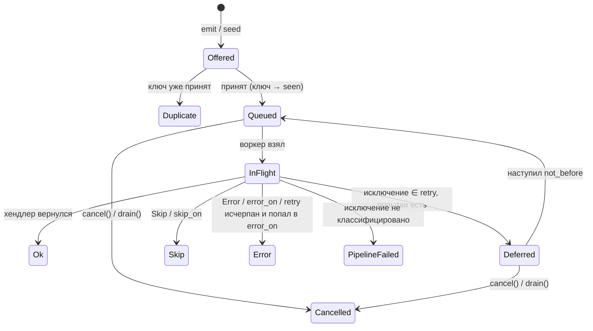

# staged-pipeline — архитектура и API v1

> Статус: предложение к утверждению (2026-10-24). Постановка — [../staged-pipeline-library.md](../staged-pipeline-library.md),
> ресёрч аналогов — [research.md](research.md). Здесь — итоговые решения; где они расходятся с
> черновиком, это отмечено в §12.

## 0. Коротко

- **Одна сущность — `Stage`.** Источник — это стадия, которой засеяли вход и дали async-генератор.
  Отдельного понятия `source` нет.
- **Режим завершения выводится из графа.** Параметра `termination=` нет: библиотека находит циклы
  (SCC) и для DAG-части закрывает по писателям, для цикла — по quiescence. Выбрать неправильный режим
  и повиснуть нельзя.
- **Судьба исключения объявляется на стадии, как в Tallyho**: `retry=`, `skip_on=`, `error_on=`;
  неклассифицированное исключение роняет пайплайн (fail-fast по умолчанию — громко, а не тихо).
- **Выход хендлера — через `return`/`yield`, исход — через исключения** (`Skip`, `Error` или доменные,
  смапленные в `skip_on/error_on`). Это единственная схема, которая одинаково работает для корутин и
  генераторов.
- **Словарь прогресса — тот же, что у Tallyho `Progress`**: `found / queued / in_flight / deferred /
  ok / skip / error / cancelled / duplicates / expected / expected_is_estimate / eta / final`.
  Общий язык, а не общий код: зависимости между библиотеками нет.
- **Интеграция с Tallyho — да, тонкая** (extra, ~80 строк, через структурный `Protocol`): живой
  прогресс в `item.progress`, итоговые счётчики в `item.incr`, мост отмены `item.cancelled() → drain`.
  Встраивать пайплайн в Tallyho или Tallyho в пайплайн — нет (§9).

## 1. Границы

Внутри одного процесса и одного event loop; не durable; не владеет хранилищем; не распределённая.
Устойчивость между прогонами — БД домена (resume засевом) и Tallyho (единица ретрая — Item).
Python **3.13+** (D-002): ядро на `TaskGroup` и собственной очереди (§7.1).
Зависимостей в ядре нет.

## 2. Правила из ресёрча, которые формируют API

| Правило | Как выражено |
|---|---|
| Fail-fast гасит всё, включая upstream; `run()` вернулся ⇒ воркеров нет | единый супервизор на весь граф (§7.3) |
| Fan-in закрывается после **всех** писателей | писатели = рёбра графа, библиотека считает их сама |
| Цикл → quiescence с инкрементом до `put` | счётчик SCC, emit учитывается до выхода родителя (§7.2) |
| Ничего не теряется молча | нет маршрута → `RoutingError`; отмена → `cancelled`; дубль → `duplicates` |
| Ошибка наружу плоская | наружу исходное исключение + `add_note()` со стадией и ключом |
| Обработанная ошибка видна | лог WARNING по умолчанию + счётчик + метка |
| Retry не держит слот, обходит dedup | отложенная очередь `not_before`; ключ seen с момента приёма |
| Bounded внутри цикла запрещён | `TopologyError` при старте |
| Лимитер не держится, пока ждём место внизу | permit берётся вокруг вызова хендлера, `emit` вне permit-а (§7.5) |
| Воркеры — свои задачи | генератор хендлера крутит воркер, а не потребитель |

## 3. Модель



| Понятие | Что это |
|---|---|
| `Pipeline` | граф + супервизор + часы. Одноразовый: один `run()` |
| `Stage[In, Out]` | inbox + пул воркеров + политика ошибок + dedup + счётчики |
| ребро | `a.to(b)`; маршрутизация по типу выхода, если рёбер несколько |
| inbox | готовые элементы (FIFO) + отложенные (heap по `not_before`) |
| seed | вход извне до/во время `run()`; закрывается `seal()` (неявно при старте, если не `open=True`) |
| исход элемента | `ok` (+метка) · `skip(label)` · `error(label)` · `cancelled` · `duplicate`; либо **сбой пайплайна** |

### 3.1 Жизненный цикл элемента



### 3.2 Жизненный цикл стадии

`OPEN → CLOSING → CLOSED`, либо `→ CANCELLED / FAILED`. `CLOSING` — новых элементов не будет, воркеры
доедают inbox. Именование совпадает по смыслу с Tallyho `OPEN → SEALED → SUCCEEDED/…`.

## 4. API

### 4.1 Сборка и запуск

```python
from staged_pipeline import Pipeline, Retry, Expo, Skip, Error, ErrorRate, NoSuccess

pipe = Pipeline("mail", clock=None, observer=None, log=logger)

stage = pipe.stage(
    "resolve",                 # имя: ключ в снимке и в логах
    handle,                    # async def / async gen; (item) или (item, ctx)
    workers=16,
    buffer=None,               # None = unbounded (умолчание); int = bounded
    key=lambda ref: ref.thread_id,   # dedup; None = без dedup
    retry=Retry(on=(NetError, TimeoutError), attempts=3, backoff=Expo(0.5, cap=10)),
    skip_on={NotFound: "deleted"},   # класс → метка | (exc) -> метка
    error_on={ParseError: "bad_mime"},
    abort_if=ErrorRate(1.0, min_samples=20),   # или NoSuccess(), или свой Breaker
    limits=[armgs],            # общие лимитеры (§4.5)
    executor=None,             # "thread" → sync-хендлер в asyncio.to_thread
    warn_queued=50_000,
)

report = await pipe.run(timeout=None)   # PipelineReport; при сбое — исходное исключение
```

- `pipe.stage(...)` возвращает `Stage[In, Out]`; `In` и `Out` выводятся из аннотаций хендлера
  (для pyright — через overload-ы `Callable[[In], Awaitable[Out]]`, `Callable[[In], AsyncIterator[Out]]`).
- Граф неизменяем после `run()`; повторный `run()` — `RuntimeError`.
- `run()` проверяет топологию до старта (§7.6) и бросает `TopologyError` без запуска чего-либо.

### 4.2 Рёбра и маршрутизация

```python
listing.to(resolve)                        # один выход
page.to(pages, images)                     # несколько: по типу выхода (isinstance к In стадии)
page.to(pages, images, fallback="error")   # "error" (умолчание) | "drop" — считается в metrics
```

Неоднозначность (выход подходит к двум стадиям) и непокрытый член `Union` в аннотации — `TopologyError`
при старте. Выход, не подошедший ни к одной стадии, в рантайме — `RoutingError` (сбой пайплайна) или,
при `fallback="drop"`, счётчик `unrouted`. Стадия без `.to()` с непустым выходом — тоже `TopologyError`:
выход-не-`None` у терминальной стадии — почти всегда баг.

### 4.3 Хендлер: выход и исход

```python
async def resolve(ref: ThreadRef) -> list[AttachmentSpec]:      # атомарный fan-out
    ...
async def scan(folder: Folder) -> AsyncIterator[ThreadRef]:      # потоковый fan-out
    async for tid in ...:
        yield ThreadRef(folder.id, tid)
async def download(spec: AttachmentSpec, ctx: StageContext) -> None:   # терминальная
    if await storage.has(spec):
        raise Skip("already_stored")
    ctx.label("saved"); ctx.incr("bytes", n)
```

| Хендлер возвращает | Что уходит дальше |
|---|---|
| `None` | ничего |
| `Out` | один элемент |
| `list[Out]` / `tuple` | все сразу **после** успеха; при исключении — ничего (атомарно) |
| `AsyncIterator[Out]` | каждый `yield` сразу (потоково); при исключении уже выданное остаётся |

Исход — исключениями: `raise Skip("label")`, `raise Error("label")` (библиотечные, `Exception`-подклассы)
или доменные классы через `skip_on/error_on`. Ok-метка — `ctx.label("with_files")`, по умолчанию `"ok"`.
`BaseException` (в т.ч. `CancelledError`) не классифицируется никогда.

**Ретрай потокового хендлера** выдаст первые элементы ещё раз. Поэтому стадия с `retry=` и
генератором требует `key=` у всех стадий-получателей, иначе `TopologyError` («повтор генератора без
dedup внизу»). Для `list` такого требования нет.

`StageContext`: `stage`, `key`, `attempt`, `label(str)`, `incr(name, n=1)`, `expect(stage, add=n)`,
`clock`. Хендлер без второго параметра контекст не получает (определяется по сигнатуре один раз).

### 4.4 Классификация исключения

Порядок, ближайший класс по MRO (как `*_on` в Tallyho):

1. `Skip` / `Error` библиотеки → исход как есть.
2. Класс в `retry.on` и попытки не исчерпаны → `deferred`, элемент в отложенную очередь
   (`not_before = now + backoff(attempt)`), слот свободен.
3. `skip_on` → `skip(label)`; `error_on` → `error(label)`. Сюда же попадает исключение после
   исчерпания ретраев (метка по маппингу; если маппинга нет — шаг 4).
4. Иначе — сбой пайплайна: исходное исключение + `exc.add_note("stage=resolve key=… attempt=2")`.

Класс одновременно в `skip_on` и `error_on` — `ConfigurationError` при создании стадии.
Каждый `skip/error` логируется: WARNING одной строкой (`стадия ключ: Тип: текст`), DEBUG — трейсбек.
Уровни настраиваются `log_levels=`.

### 4.5 Предохранители и лимиты

```python
abort_if=ErrorRate(threshold=0.9, min_samples=20, labels=None)   # во время работы
abort_if=NoSuccess()        # при закрытии: ok == 0 и error > 0 (замена «не прочитан ни один тред»)
abort_if=[ErrorRate(...), NoSuccess()]
```

Срабатывание — сбой пайплайна. Наружу — **последнее исходное исключение стадии** с заметкой
`aborted by ErrorRate(...) at resolve: 20/20 errors` (если исходного нет, например только `raise Error`,
— `StageAborted`). Исходный класс важен: Tallyho снаружи мапит его через `defer_on/error_on`.

```python
armgs = Limit(concurrency=24, rate=40, per=1.0)   # concurrency и/или token bucket
pipe.stage("resolve", ..., limits=[armgs])
pipe.stage("media", ..., limits=[armgs.weighted(2)])
```

Протокол `Limiter`: `def acquire(self, weight: int = 1) -> AbstractAsyncContextManager[None]`.
Адаптер capacity-governor реализует тот же протокол (extra).

### 4.6 Засев, dedup, resume

```python
media.seed(pending_specs)                 # до или во время run(); элементы проходят dedup
resolve.resume(done_keys, label="resumed")   # ключи уже сделанного: при встрече → skip("resumed")
listing.seed(folders)                     # вход стадии закрывается при старте run()

feed = urls.seed_open()                   # открытый вход: Feeder; put()/close()
await feed.put(url); feed.close()         # без close() стадия не закроется (как seal=False в Tallyho)
```

- `resume()` отличается от «просто seen»: встреченный ключ попадает в `found` и `skip`, поэтому
  прогресс показывает полный объём, а не только остаток (сейчас это `threads_resumed` в `ExportMeter`).
- Ключ помечается принятым при приёме, ретрай dedup не проходит повторно.
- Хранилище ключей — протокол `SeenStore` (`add(key) -> bool`, `__contains__`); v1 — `set`.

### 4.7 Остановка

```python
pipe.cancel(reason="timeout")         # немедленно: воркеры отменены, остаток → cancelled
await pipe.drain(timeout=30)          # входы закрыты, генераторы источников закрыты (aclose),
                                      # in-flight доделываются, queued/deferred → cancelled;
                                      # по таймауту → cancel()
```

Обе идемпотентны. `run()` после `cancel/drain` возвращает отчёт с `report.stopped = "cancel" | "drain"`,
а не бросает исключение: остановка по просьбе — не сбой. Внешний `CancelledError` (таймаут FlexiQ)
пробрасывается как есть после корректного гашения всех воркеров.

### 4.8 Прогресс и наблюдение

```python
view = pipe.view()            # синхронный, дешёвый снимок: PipelineView
async for view in pipe.watch(interval=1.0): ...   # заканчивается терминальным снимком
report = await pipe.run()     # PipelineReport = последний view + длительность + stopped
```

`StageView` — поля как у Tallyho `Progress` плюс локальные:

| Поле | Смысл |
|---|---|
| `state` | `OPEN / CLOSING / CLOSED / CANCELLED / FAILED` |
| `found` | принято уникальных (+ resumed) |
| `queued`, `in_flight`, `deferred` | ждут, в работе, ждут ретрая |
| `ok`, `skip`, `error`, `cancelled`, `duplicates` | исходы; `done = ok+skip+error+cancelled` |
| `labels`, `metrics` | `Counter` меток исходов и `ctx.incr` |
| `expected`, `expected_is_estimate`, `estimate_basis` | §6 |
| `final` | стадия закрыта, числа окончательные |
| `rate`, `latency`, `eta` | EWMA завершений/с, EWMA длительности хендлера, оценка |
| `emitted` | `{"media": 2104}` — выход по рёбрам (база для fan-out ratio) |

`Observer`-протокол (все методы опциональны): `stage_closed`, `item_finished(stage, key, outcome, exc)`,
`breaker_tripped`, `queued_warning`. Логирование — дефолтный observer.

### 4.9 Тест-утилиты

```python
from staged_pipeline.testing import run_stage, FakeClock

out = await run_stage(resolve, [ref1, ref2], retry=..., clock=FakeClock())
assert out.outputs == [...]; assert out.view.skip == 1
```

`FakeClock` — то же имя и смысл, что в `tallyho.testing`.

## 5. Семантика, которую фиксирует контракт

1. Порядок элементов не гарантируется.
2. At-most-once внутри прогона для элемента с ключом; без ключа дубли допустимы.
3. `run()` вернулся или бросил ⇒ ни одного живого воркера, генераторы хендлеров закрыты (`aclose`).
4. Инвариант на любой снимок: `found = queued + in_flight + deferred + done` (проверяется в тестах).
5. Счётчики меняются только в одной точке — переходе состояния элемента (§7.4).

## 6. Объём и ETA

Правило `expected` для стадии — то же, что в Tallyho ([counters.md](../../talyho/docs/architecture/counters.md)), чтобы
числа в CLI и в дашборде батча читались одинаково:

| Условие | `expected` | estimate |
|---|---|---|
| стадия `CLOSED`/`CLOSING` и все её писатели закрыты | `found` | нет |
| задан `stage.expect(n)` / `ctx.expect(stage, add=n)` | `max(found, n)` | да |
| у всех писателей есть `expected` и выборка ≥ min(20, 5%) | `Σ по рёбрам emitted/done_писателя × expected_писателя` | да |
| стадия в цикле и не закрыта | `None` (только found vs done — «фронтир») | — |
| иначе | `None` | — |

`eta = (expected − done) / rate`, при `expected is None` — `None`. ETA пайплайна — максимум по стадиям,
если у всех есть `eta`.

## 7. Внутреннее устройство

### 7.1 Модули

```
staged_pipeline/
  __init__.py        # Pipeline, Stage, Skip, Error, Retry, Expo, Fixed, Limit, ErrorRate, NoSuccess, ...
  _graph.py          # рёбра, SCC (Tarjan), валидация, вывод типов из аннотаций
  _inbox.py          # Inbox: deque + heap(not_before) + waiters; close/cancel с учётом остатка
  _stage.py          # Stage, воркер-цикл, нормализация выхода, emit
  _policy.py         # Retry, backoff, классификация, Breaker-ы
  _supervisor.py     # TaskGroup-обёртка: первый сбой, отмена всех, плоское исключение
  _accounting.py     # счётчики, единственная функция перехода, SCC-счётчики, закрытие
  _progress.py       # StageView/PipelineView, EWMA, expected, ETA
  _limit.py          # Limiter-протокол, Limit (семафор + token bucket)
  _clock.py          # Clock-протокол, MonotonicClock
  testing.py         # run_stage, FakeClock
  integrations/tallyho.py   # extra [tallyho], без import tallyho (§9.2)
```

Своя очередь вместо `asyncio.Queue`: нужны отложенные элементы, учёт остатка при отмене
(`Queue.shutdown(immediate=True)` теряет его молча) и проверка закрытия без гонок. Это ~80 строк.

### 7.2 Завершение — единый алгоритм

При старте граф разбивается на компоненты сильной связности. Компонента без самопетли из одной
стадии — обычная DAG-стадия.

```
pending(C)   = Σ (queued + in_flight + deferred) по стадиям компоненты C
writers(C)   = число открытых внешних входов C: рёбра из других компонент + открытые seed-входы

C закрывается, когда writers(C) == 0 и pending(C) == 0
закрытие C ⇒ для каждой компоненты D, куда ведут рёбра из C: writers(D) -= 1
```

- Для DAG-стадии это ровно feeder counting из черновика; для цикла — quiescence.
- `emit` ребёнка учитывается (`queued += 1`) **синхронно, до** того как родитель покинет `in_flight`.
  Проверка закрытия вызывается после каждого декремента `pending` и после каждого `writers -= 1`;
  между учётом и проверкой нет `await`, поэтому в одном loop она атомарна.
- Отложенный ретрай входит в `pending` — компонента не закроется с элементом, ждущим backoff.

### 7.3 Супервизор и ошибки

Одна `TaskGroup` на весь пайплайн (все воркеры всех стадий + watcher таймаутов). Первый сбой
записывается **хронологически** (а не `eg.exceptions[0]`, где порядок не гарантирован), остальные
воркеры отменяются, ждущие на `get/put` будят `cancel()` очередей. Наружу — записанное исключение;
`ExceptionGroup` разворачивается. Внешний `CancelledError` не подменяется.

### 7.4 Воркер

```
loop:
  env = await inbox.get()                 # None → стадия закрыта → выход
  account.start(env)                      # queued→in_flight
  try:
      async with limits(env):             # permit только на вызов
          result = await call(handler, env)   # для генератора — до первого yield
      route(result)                       # emit вне permit-а; bounded downstream может ждать
      account.finish(env, ok, label)
  except BaseException → classify → account.finish(...) / defer / raise
  finally: check_close()
```

Для генератора: каждый `__anext__` — под permit-ом, каждый `emit` — без; генератор обёрнут в
`contextlib.aclosing`, чтобы отмена закрывала его детерминированно.

### 7.5 Почему permit отпускается на emit

Иначе классический deadlock (futures-rs#2387, рекурсивный `errgroup.Go`): воркер держит общий
лимит и ждёт места в bounded-стадии, чьи воркеры ждут этот же лимит.

### 7.6 Проверки топологии при старте

- bounded-буфер у стадии в цикле;
- терминальная стадия, чья аннотация выхода не `None`;
- неоднозначный или непокрытый маршрут по типу;
- стадия без входа (нет рёбер и нет seed) — предупреждение, не ошибка (закроется сразу);
- `retry` + генератор → получатели без `key`;
- класс в двух `*_on`.

## 8. Миграция `checker_account/export/service.py`

Уходит: `_run_all`, `_pool`, `_MailRun` целиком, ручной dedup, счётчики `ExportMeter` для стадий,
проверка «не прочитан ни один тред», try/except с логированием в стадиях. Остаётся домен.

```python
@dataclass(frozen=True, slots=True)
class ThreadRef:
    folder: str
    thread_id: str


async def _collect(self, job_id, identity_id, reader, folders, window) -> PipelineReport:
    t, repo = self._tuning, self._repo
    pipe = Pipeline("mail", log=logger)

    async def scan(folder: Folder) -> AsyncIterator[ThreadRef]:
        async for thread_id in scan_folder(reader, folder.id, window):
            yield ThreadRef(folder.id, thread_id)

    async def resolve(ref: ThreadRef) -> list[AttachmentSpec]:
        return await fetch_thread(reader, repo, job_id, ref.folder, ref.thread_id)

    async def download(spec: AttachmentSpec) -> None:
        status = await fetch_attachment(reader, repo, self._blobstore, job_id, identity_id, spec)
        if status is not AttachmentStatus.STORED:
            raise Error("not_stored")      # строка остаётся PENDING → докачается на resume

    async def contacts(_: None, ctx: StageContext) -> None:
        await collect_contacts(reader, repo, job_id, on_saved=lambda: ctx.incr("contacts"))

    listing = pipe.stage("list", scan, workers=t.list_workers)
    threads = pipe.stage(
        "resolve", resolve, workers=t.resolve_workers,
        key=lambda r: r.thread_id,
        error_on={Exception: "failed"},        # было: except Exception → threads_failed
        abort_if=NoSuccess(),                  # было: RuntimeError «не прочитан ни один тред»
    )
    media = pipe.stage(
        "media", download, workers=t.media_workers,
        key=lambda s: s.attachment_id,
        error_on={Exception: "store_failed"},
    )
    pipe.stage("contacts", contacts, workers=1).seed([None])

    listing.to(threads)
    threads.to(media)
    listing.seed(folders)
    threads.resume(await repo.resolved_threads(job_id), label="resumed")
    media.seed(await repo.pending_attachments(job_id))
    return await pipe.run()
```

- `NoSuccess()` = `ok == 0 and error > 0` при закрытии; resumed-треды идут в `skip`, на условие не
  влияют. Поведение строже текущего: сейчас любой resume отключает проверку целиком, а здесь «после
  рестарта все оставшиеся треды упали» тоже уронит экспорт. Если это нежелательно —
  `NoSuccess(count_labels={"resumed"})`.
- `ExportMeter` и `render_card` переходят на `PipelineView` (`view.stages["resolve"].queued` и т.д.);
  фаза («вход/сборка zip») остаётся доменной строкой рядом.
- `ExportTuning` и комментарии с замерами остаются в домене — это знание об armgs, а не о пайплайне.
- Чистый выигрыш по коду: ~110 строк инфраструктуры → ~45 строк декларации; плюс бесплатно: ETA по
  стадиям, ретраи с backoff для тредов (сейчас их нет — сбой сразу в `threads_failed`), drain по
  таймауту FlexiQ.

## 9. Tallyho: интегрировать ли и как

### 9.1 Вывод

Да, но как **адаптер прогресса и остановки**, а не как общий движок.

| Вариант | Решение | Почему |
|---|---|---|
| Пайплайн как режим Tallyho (`tallyho.local`) | нет | Tallyho держится на PG-гарантиях (outbox, аренда, at-least-once, финализация ровно один раз). Локальный режим без них — другая библиотека под тем же именем, и пользователь не поймёт, какие гарантии где |
| Tallyho как зависимость ядра | нет | ядро без зависимостей; тянуть SQLAlchemy ради счётчиков нельзя |
| Общий словарь (`Progress`, `Ok/Skip/Error`, `*_on`, `expected`, `FakeClock`) | **да** | один ментальный образ на двух масштабах; рендеры прогресса переиспользуются |
| Extra `staged_pipeline.integrations.tallyho` | **да** | прогресс Item, метрики батча, мост отмены |

### 9.2 Где граница: этапы Tallyho или пайплайн внутри Item

Туториал Tallyho «Экспорт почты» делает те же стадии (pages → messages → attachments) под-батчами.
Это правильный выбор, когда:

| Критерий | Этапы Tallyho (`sub_batch` + `fed_by`) | Пайплайн внутри Item |
|---|---|---|
| Элемент должен пережить падение воркера сам по себе | ✔ | ✘ (resume — через БД домена) |
| Элементы дешёвые (≪ 100 мс) и их 10⁴–10⁶ на единицу | дорого: строка + коммит на элемент | ✔ |
| Общая сессия/лиз/соединение на единицу (armgs + IH) | ✘ (лиз на задачу → логины, лок-аут) | ✔ |
| Масштаб на несколько машин | ✔ | ✘ |
| Нужен точный итог по каждому элементу в БД | ✔ (`on_finalized`) | домен пишет сам |

Для armgs-экспорта — пайплайн внутри Item `export_one` (как сейчас). Гибрид работает: Tallyho
считает аккаунты, пайплайн — треды и вложения внутри аккаунта.

### 9.3 Адаптер

Адаптеру нужны три метода `WorkItem`; описываем их структурным `Protocol` — `import tallyho` не нужен:

```python
class TallyhoItemLike(Protocol):
    def progress(self, done: int, total: int | None = None) -> None: ...
    def incr(self, name: str, value: int = 1) -> None: ...
    def cancelled(self) -> bool: ...
```

```python
from staged_pipeline.integrations.tallyho import track, outcome_for
from tallyho import item

@fq.task(max_retries=2, timeout=1800, defer_on={RateLimited: timedelta(minutes=10)})
async def export_one(identity_id: str, exporter: FromDishka[MailboxExporter], ...) -> Ok | Error:
    async with source.lease_reader(UUID(identity_id)) as (leased, reader):
        pipe = exporter.build(leased, reader, window)
        async with track(pipe, item.require(), every=2.0, drain_timeout=30, weights={"media": 3}):
            report = await pipe.run()
    return outcome_for(report, partial_if=lambda r: r.stages["media"].error > 0)
    # Ok("exported") | Ok("partial") — метка видна в view.labels батча
```

`track(...)`:

| Что | Куда | Видно в Tallyho |
|---|---|---|
| раз в `every` с: `done`/`expected` по стадиям с весами | `item.progress(done, total)` | `handle.in_flight()[i].progress_done/total` — живой прогресс аккаунта |
| на выходе: `ok/skip/error/duplicates` и метки каждой стадии | `item.incr("resolve.ok", n)`, `item.incr("media:not_stored", n)` | `view.metrics` батча — сумма по всем аккаунтам за сутки |
| `item.cancelled()` стал `True` | `pipe.drain(drain_timeout)` | кооперативная отмена батча гасит экспорт аккуратно |
| сбой `abort_if` | исходное исключение наружу | маппится `defer_on/error_on` задачи |

`incr` пишется только при выходе (Tallyho копит метрики в буфере итога), поэтому на неуспешной
попытке они не задваиваются — это поведение Tallyho, адаптер ничего не делает сверх.

### 9.4 Чего не хватает в Tallyho (на заметку, не блокирует)

- `item.progress` — диагностика аренды, в `ratio`/`eta` батча не входит. Для батча из 20 долгих
  аккаунтов ETA батча считается по завершениям Item-ов и минутами стоит на месте. Возможное
  улучшение Tallyho: учитывать `progress_done/total` выполняющихся Item-ов в `ratio` (дробный вклад).
- Живых метрик Item нет (`incr` — только на finish). Для дашборда «сколько вложений скачано за сутки
  прямо сейчас» нужен либо heartbeat-flush метрик, либо `on_progress`-хук приложения.

## 10. План работ

Задачи, порядок и гейты — [plan/PLAN.md](plan/PLAN.md), статус — [plan/PROGRESS.md](plan/PROGRESS.md).
Весь объём §4 входит в 0.1.0; после — стабилизация API к 1.0 и бенчмарк оверхеда
(цель < 20 мкс накладных на элемент).

Обязательные тесты: завершение DAG и цикла (включая «последний элемент порождает детей»), ретрай не
даёт закрыться раньше времени, отмена при ожидании на bounded `put`, генератор закрыт после
cancel, инвариант счётчиков на каждом шаге (property-based, hypothesis), плоское исключение с заметками.

## 11. Закрытые вопросы

1. Неклассифицированное исключение — fail-fast (D-001).
2. Python 3.13+ (D-002).
3. Имя пакета — `staged-pipeline` (D-008, можно сменить до публикации).

План реализации — [plan/PLAN.md](plan/PLAN.md).

## 12. Отличия от черновика

| Черновик | Здесь | Почему |
|---|---|---|
| `Pipeline(termination="feeders"\|"in_flight")` | режим выводится из SCC | ошибка выбора = вечное ожидание; граф и так известен |
| `pipe.source(fn)` отдельно от стадий | источник = стадия + `seed` | одна модель политик, метрик и воркеров (решение §11.1-6 становится бесплатным) |
| `errors=Skip(on_error=...)` / `Retry(then=...)` | `retry=`, `skip_on=`, `error_on=` по классам | разные исключения — разная судьба; совпадает с Tallyho |
| `on_done(item, result)` | убран; выход идёт по рёбрам, итог — в счётчиках/observer | запись в БД и так делает хендлер |
| `mark_seen` | `resume(keys, label=)` | resumed попадают в `found/skip` — прогресс честный |
| `TotalKind` EXACT/HINTED/INFERRED/UNKNOWN | `expected` + `expected_is_estimate` + `estimate_basis` | то же самое, но поля как в Tallyho |
| `.feeds()` | `.to()` | короче; направление читается слева направо |
| `asyncio.Queue` + `shutdown` | своя очередь (Python 3.13+ остаётся) | отложенные ретраи и учёт остатка при отмене |
