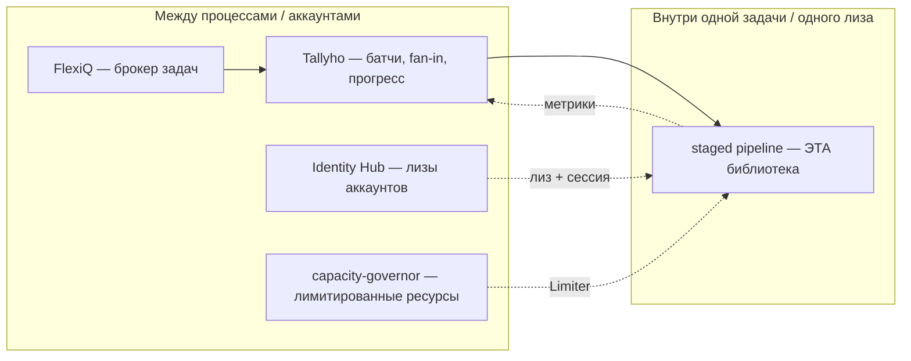
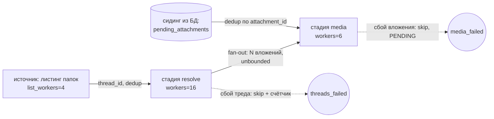
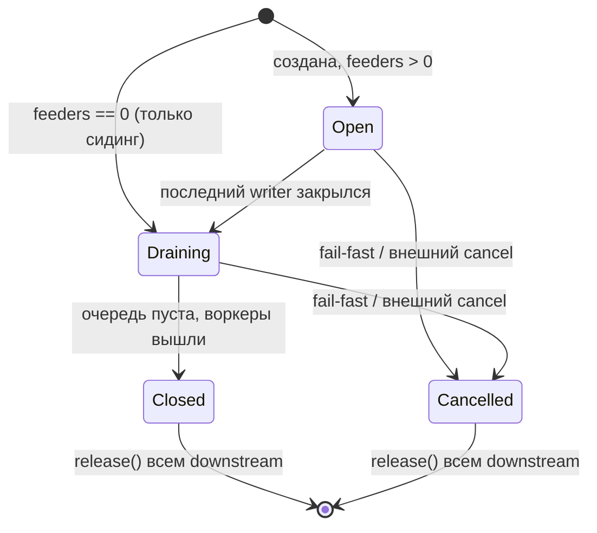
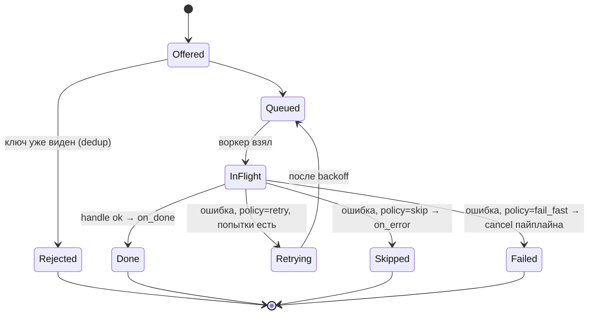
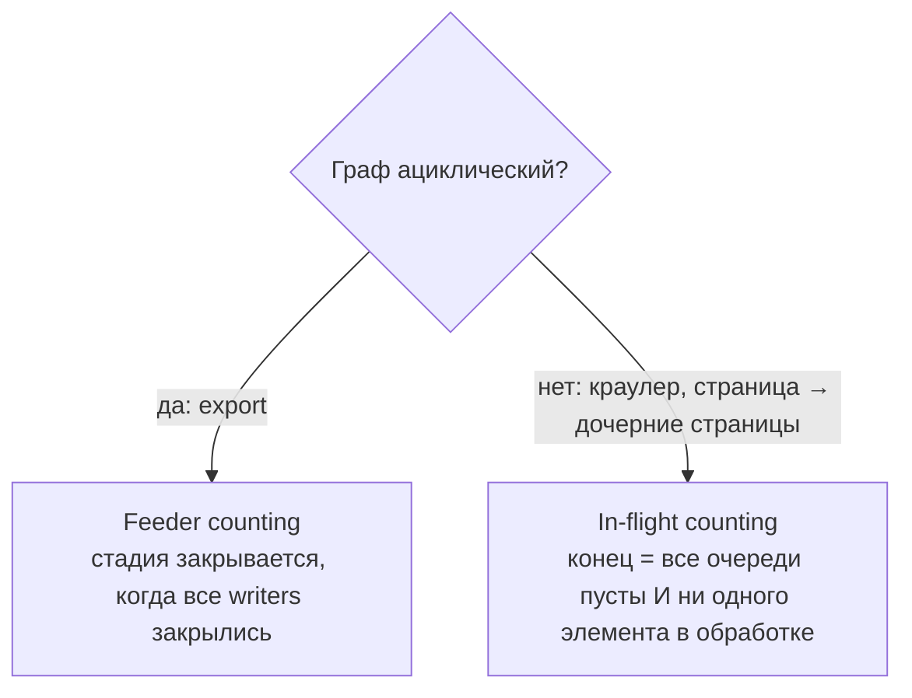

# Библиотека in-process staged pipeline — постановка задачи

> Статус: черновик / исследование. Источник задачи — `checker_account/export/service.py`
> (экспорт ящика armgs: листинг → резолв тредов → скачивание вложений).

## 1. Проблема

В каждом проекте с парсингом/экспортом заново пишется один и тот же низкоуровневый слой:

- стадии на `asyncio.Queue`, у каждой свой пул воркеров;
- каскадное завершение (листинг дочитан → shutdown очереди тредов → резолверы доели → shutdown медиа);
- дедуп элементов (тред из нескольких папок, вложение из resume и из пере-резолва);
- изоляция ошибок по элементу (сбой одного треда не роняет экспорт) + fail-fast для системных сбоев;
- сидинг из БД при resume;
- счётчики прогресса.

В `service.py` это ~80 строк инфраструктуры (`_run_all`, `_pool`, `_MailRun`, `*_stage`) вперемешку с доменом.
Цель — вынести этот слой в отдельную переиспользуемую библиотеку.

## 2. Как это называется

Единого имени нет; это комбинация паттернов:

| Что делает код | Паттерн |
|---|---|
| Стадии со своей очередью и своим пулом | **SEDA** — Staged Event-Driven Architecture (Welsh, Culler, Brewer, SOSP 2001) |
| Цепочка стадий | **Pipeline / pipes-and-filters / dataflow** |
| 1 тред → N вложений; resume + резолв → одна очередь | **fan-out / fan-in** |
| Стадия закрывается, когда закрылись все её писатели | **completion propagation** (.NET), «close when all senders done» (Go) |
| Ошибка элемента → посчитать и продолжить | **supervision strategy** (Akka: Resume / Stop / Restart) |
| `claim(key)` | **idempotent consumer / dedup** |
| Неограниченная очередь резолв → медиа | **явный разрыв backpressure** (Kotlin `buffer(UNLIMITED)`, Reactor `onBackpressureBuffer`) |

Рабочее определение: **in-process staged dataflow pipeline** — SEDA внутри одного процесса и одного event loop.

## 3. Место в экосистеме



Граница: библиотека **не** распределённая, **не** durable, **не** владеет хранилищем.
Устойчивость между прогонами — забота домена (БД) и Tallyho.

Почему именно in-process: все стадии одного ящика делят одну armgs-сессию под одним лизом IH.
Разнести треды/вложения по задачам FlexiQ = сессия и лиз на каждую задачу → лишние логины, риск лок-аута.

## 4. Референсный кейс — экспорт ящика



Ключевое требование из замеров: между resolve и media **не должно быть backpressure**.
Общий потолок отдавал слоты долгим скачиваниям → резолв 1.2 треда/с вместо 40/с.

## 5. Модель состояний

### 5.1 Жизненный цикл стадии



### 5.2 Жизненный цикл элемента



### 5.3 Определение завершения — два режима



Feeder counting не работает при самоссылке (стадия пишет сама в себя — счётчик никогда не станет 0).
In-flight counting — локальная задача termination detection (Dijkstra–Scholten); Tallyho решает её же между процессами.
Нужны оба режима.

## 6. Требования

### Must

1. **Топология**: источники, стадии, fan-out (1 → N), fan-in (несколько писателей), внешний сидинг до старта.
2. **Per-stage**: конкурентность и политика буфера (`unbounded` / `bounded(n)`).
3. **Завершение**: feeder counting (DAG) и in-flight counting (циклы).
4. **Структурная конкурентность**: fail-fast отменяет всё, никто не висит на `get()`, наружу — исходное
   исключение (не `ExceptionGroup`), внешний cancel (таймаут FlexiQ) гасит корректно.
5. **Error policy per stage**: `fail_fast` / `skip(on_error)` / `retry(attempts, backoff)` — ретрай внутри
   стадии дешевле перезапуска всей задачи.
6. **Дедуп** по ключу на стадию + засев «уже виденных» (resume).
7. **Не владеет хранилищем**: сидинг + хук `on_done(item, result)` — запись в БД делает домен.

### Should

8. **Метрики стадий**: queued, in_flight, done, failed, skipped, rate, latency + `snapshot()` (заменит большую часть `ExportMeter`).
9. **Общий `Limiter` поверх нескольких стадий** (семафор / token bucket) — сейчас нагрузку на armgs
   ограничивает «сумма пулов» вручную; реализация может прийти из capacity-governor.
10. **Типизация**: `Stage[In]`, типизированный fan-out, mypy/pyright без `Any`.

### Won't (non-goals)

- персистентность очередей;
- распределённость, межпроцессные ретраи;
- собственный планировщик/cron;
- trio / anyio-совместимость (не нужна в стеке).

## 7. Интеграции

| С чем | Как | Где |
|---|---|---|
| asyncio (Python 3.13+) | `TaskGroup`, `Queue.shutdown` — ядро без зависимостей | core |
| Tallyho | метрики пайплайна → прогресс Item (`треды 812/1400, медиа 300/2100`) | extra `[tallyho]` |
| capacity-governor | адаптер `Limiter` → лиз ресурса | extra `[governor]` |
| FlexiQ | прямой интеграции нет; опционально хук heartbeat | — |
| logging | стандартный `logging`, хуки на стадию и элемент | core |
| OpenTelemetry | **не в v1** | — |
| Dishka | не нужна в ядре — ресурсы через замыкания/контекст | — |

Вывод: **отдельная маленькая библиотека**, не плагин FlexiQ. Ядро не знает о брокерах.

## 8. Prior art — что изучить

| Экосистема | Реализация | Что взять |
|---|---|---|
| .NET | **TPL Dataflow** (`TransformManyBlock`, `ActionBlock`, `LinkTo(..., PropagateCompletion=true)`, `MaxDegreeOfParallelism`, `BoundedCapacity` — по умолчанию unbounded) | Ближайшая модель API почти 1:1 |
| Elixir | **Broadway**, GenStage, Flow | Error handling (`Message.failed`, `handle_failed`), ack-хуки, метрики, per-stage concurrency |
| Scala/Java | **Pekko (Akka) Streams**, Project Reactor | Supervision `Resume/Restart/Stop`, `mapAsyncUnordered`, `Source.queue` (внешний сидинг), `flatMap(fn, concurrency)` |
| Go | Go blog «Pipelines and cancellation», `errgroup.SetLimit`, `sourcegraph/conc` | Завершение и отмена, структурная конкурентность |
| Kotlin | Flow: `flatMapMerge(concurrency)`, `buffer(UNLIMITED)` | Явный разрыв backpressure |
| Rust | `buffer_unordered(n)`, `tokio::mpsc`, `JoinSet` | Завершение через drop всех senders = feeder counting от компилятора |
| Python | **pypeln** (`pl.task.map(f, stage, workers=N, maxsize=0)`) | Ближе всех по модели; проверить статус сопровождения |
| Python | **anyio / trio memory channels** (`send_stream.clone()`) | Канал закрывается, когда закрыты все клоны отправителя |
| Python | aiostream | Комбинаторы; **не подходит** — pull-модель = сквозной backpressure |
| Python | Crawlee, Scrapy | Router по меткам, дедуп `unique_key`; **не подходит** — общий пул и своё хранилище |
| Python | Bytewax, Faust, Ray Data | Другой масштаб (stream processing / распределённость) |

Почему готовое не берём: aiostream и GenStage тянут backpressure, Crawlee/Scrapy — общий пул и своё
хранилище, Temporal/DBOS/Hatchet — избыточны для работы внутри одного лиза.

## 9. Эскиз API

```python
from staged_pipeline import Pipeline, Retry, Skip, FailFast, Unbounded

pipe = Pipeline(termination="feeders")          # или "in_flight" для циклических графов

media = pipe.stage(
    "media", workers=6, buffer=Unbounded(),
    handle=download,                             # async (AttachmentSpec) -> AttachmentStatus
    key=lambda spec: spec.attachment_id,
    errors=Skip(on_error=media_failed),
)
threads = pipe.stage(
    "resolve", workers=16,
    handle=resolve,                              # async gen: yield AttachmentSpec — fan-out (вариант B)
    key=lambda item: item[1],
    errors=Retry(attempts=2, backoff=1.0, then=Skip(on_error=thread_failed)),
).feeds(media)
pipe.source(list_all_folders).feeds(threads)

media.seed(await repo.pending_attachments(job_id))   # resume
threads.mark_seen(resumed)                           # уже записанные треды

await pipe.run()
print(pipe.snapshot())   # {"resolve": {"done": 812, "failed": 3, ...}, "media": {...}}
```

## 10. Принятые решения

1. **Fan-out — вариант B (return/yield)**: хендлер возвращает выход (`AsyncIterator[Out]` или
   `Out | list[Out] | None`), библиотека маршрутизирует. Рёбра графа известны библиотеке →
   автоматический feeder counting, проверка типов на `.feeds()`, чистые хендлеры в тестах,
   метрики по рёбрам (fan-out ratio).
2. **Маршрутизация — по типу выхода, не по строковым меткам**: `stage.route({PageRef: pages, ImageRef: images})`.
   Это часть топологии (как `.feeds()`), а не бизнес-логика. Решение «куда» принимает хендлер,
   выбирая тип результата. Предикаты на рёбрах — не в v1. Покрытие Union проверяется при старте.
3. **Метрики в ядре**: счётчики, latency, rate (EWMA), total с видом точности, ETA. Домен —
   `expect()` и свои счётчики через `ctx.count()`. Экспорт снимка — extras (Tallyho, CLI).
4. **OpenTelemetry — не в v1.**
5. **Total — модель с видом точности** (`TotalKind`), см. §12.

## 11. Закрытые вопросы

Открытых вопросов нет. Ниже — решения по каждому.

### 11.1 Блокируют v1 — входят в v1

| # | Вопрос | Решение |
|---|---|---|
| 1 | Как хендлер получает ресурсы (reader, repo, сессия) | Ресурсы — через замыкания. Опциональный `ctx: StageContext` вторым аргументом хендлера (`ctx.count()`, `ctx.stage_name`, `ctx.attempt`). Библиотека не знает про Dishka |
| 2 | Контракт возврата хендлера | Поддерживаются `AsyncIterator[Out]`, `Out`, `list[Out]`, `None`; внутри нормализуются в один вид. `list` — атомарный выход (на сбое ничего не уходит), `yield` — потоковый |
| 3 | Ретрай: держать слот или вернуть в очередь | Элемент возвращается в очередь с `not_before = now + backoff`; слот воркера освобождается. Воркер, взявший элемент раньше срока, откладывает его и берёт следующий |
| 4 | Аварийный порог стадии (аналог «не прочитан ни один тред») | Политика `Skip(on_error, abort_if=FailureRate(min_samples=20, threshold=1.0))` — circuit breaker на стадии; при срабатывании конвейер падает с исходной причиной. Проверка уходит из домена в политику |
| 5 | Остановка извне (таймаут FlexiQ, SIGTERM) | Два режима: `cancel()` — немедленно; `drain(timeout)` — доесть in-flight, новое не брать, по таймауту → `cancel()`. Элементы из очередей теряются — допустимо, resume идёт из БД домена |
| 6 | Ошибки источника | Источники используют ту же модель error policy, что и стадии (`FailFast` / `Skip` / `Retry`) |

### 11.2 Входят в v1 в минимальном виде

| # | Вопрос | Решение |
|---|---|---|
| 7 | Память unbounded-очереди | v1: метрика `queued` + warning в лог при пороге `warn_queued`. Soft-limit с переключением на backpressure — v1.x |
| 8 | Память дедупа | v1: in-memory `set` за протоколом `SeenStore`. Bloom / Redis / PG-реализации — по необходимости |
| 9 | CPU-хендлеры (парсинг HTML, MIME) | `stage(..., executor="thread")` → `asyncio.to_thread`. Входит в v1 |
| 10 | Форма `Limiter` | Протокол `async with limiter.acquire(weight=1)`; один limiter можно повесить на несколько стадий. Адаптер capacity-governor — extra |
| 11 | Порядок элементов | Порядок не гарантируется (unordered) — фиксируется в контракте |
| 12 | Тест-утилиты | `run_stage(stage, items) -> outputs` для изолированного прогона стадии + инъекция `clock` для rate/ETA |

### 11.3 Вне v1

| # | Вопрос | Решение |
|---|---|---|
| 13 | Бесконечные источники (мониторинг Tennet) | Не в v1. Отдельный режим работы: lag вместо ETA, нет завершения |
| 14 | Название пакета | Рабочее название `staged-pipeline`; финальное выбирается перед публикацией |
| — | OpenTelemetry | После v1 |
| — | Предикаты на рёбрах, приоритеты, выбор стадии по имени в рантайме | Не в v1 |

## 12. Total и ETA — классы задач

| Класс | Пример | Total | ETA |
|---|---|---|---|
| Закрытое множество | прочекать 1000 доменов, отправить 1000 писем с аккаунта | `EXACT` с момента `seed()` | сразу |
| Известные стадии, неизвестные элементы | экспорт ящика: папки → треды → вложения | `EXACT` по мере закрытия writers (каскад), до этого `HINTED`/`INFERRED`/`UNKNOWN` | по стадиям, уточняется |
| Подсказка домена | armgs отдаёт число писем в папке | `HINTED` через `stage.expect(n)` | оценка |
| Выводимый по fan-out | вложений ≈ треды × наблюдаемое среднее вложений на тред | `INFERRED` (библиотека считает сама по рёбрам) | оценка |
| Рекурсивный / цикл | краулер страница → страницы | `UNKNOWN`; есть discovered vs finished (фронтир) | нет |
| Бесконечный поток | мониторинг Telegram-каналов | нет | нет; только rate и lag |

Приоритет источника total для стадии: `EXACT` (все writers закрыты) → `HINTED` → `INFERRED` → `UNKNOWN`.
ETA конвейера = max ETA стадий, если у всех total не `UNKNOWN`; иначе `None`.

## 13. Следующие шаги

1. Пройти исходники TPL Dataflow, Broadway, pypeln, anyio streams — сверить решения из §10–11 с их реализацией.
2. Утвердить API (§9) и модель состояний (§5) с учётом §11.
3. Реализовать ядро + тесты на завершение (DAG и цикл), отмену (`cancel`/`drain`), политики ошибок
   (включая `abort_if`), ретрай с `not_before`.
4. Перевести `checker_account/export/service.py` на библиотеку — референсная миграция.
5. Extras: Tallyho-прогресс, capacity-governor `Limiter` (OTel — после v1).
